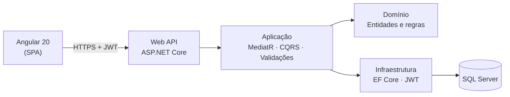

<div align="center">


# SerraDrive

**Sistema web para gestão de locadoras de veículos**
Funcionários, frota, clientes, condutores, planos de cobrança e aluguéis com devolução, com acesso por perfil e dados isolados por empresa.


</div>

---

## 📑 Sumário

- [Sobre o projeto](#-sobre-o-projeto)
- [Funcionalidades](#-funcionalidades)
- [Regras de negócio](#-regras-de-negócio)
- [Tecnologias](#-tecnologias)
- [Arquitetura](#-arquitetura)
- [Como executar](#-como-executar)
- [API](#-api)
- [Estrutura de pastas](#-estrutura-de-pastas)
- [Roadmap](#-roadmap)
- [Autor](#-autor)

---

## 📖 Sobre o projeto

O sistema permite que uma **empresa locadora** crie sua conta, cadastre seus **funcionários** e organize sua operação: grupos de veículos, preços de combustível e, nas próximas etapas, frota, clientes, aluguéis e devoluções.

Cada empresa enxerga **apenas os próprios dados** (multiempresa), e o que cada pessoa pode fazer depende do seu **perfil**: o administrador da empresa gerencia tudo, enquanto o funcionário executa as tarefas operacionais e cuida do próprio cadastro.

> Projeto de estudo desenvolvido a partir de uma especificação da formação da **Academia do Programador**.

---

## ✨ Funcionalidades

### Já implementado

| Módulo | O que faz |
|---|---|
| 🔐 **Autenticação** | Registro da empresa, login, renovação automática da sessão e logout. |
| 👥 **Funcionários** | Cadastro, edição, exclusão e listagem. Ativar e desativar contas. O funcionário acessa o sistema e edita o próprio perfil (**Meu Perfil**). |
| 🚙 **Grupos de Veículos** | Cadastro, edição, exclusão e listagem de grupos (ex.: utilitário, esportivo, adaptado para PCD). |
| ⛽ **Configurações** | Preço por litro da gasolina, gás, diesel e álcool e diária do seguro (cliente e terceiros), usados no cálculo dos aluguéis. |
| 💲 **Planos de Cobrança** | Um plano por grupo de veículos, com três modalidades: Diário, Controlado e Livre. |
| 🚘 **Automóveis** | Cadastro da frota com foto (JPEG, PNG ou WebP), placa única e filtro por grupo. |
| 🧾 **Taxas e Serviços** | Catálogo de itens extras (GPS, cadeirinha...), de cobrança fixa ou diária. |
| 🏢 **Clientes** | Pessoa física (CPF, RG, CNH) e jurídica (CNPJ), com vínculo opcional da pessoa física a uma empresa. |
| 🪪 **Condutores** | Quem dirige o veículo, ligado a um cliente. Aviso de CNH vencida e opção "cliente é condutor". |
| 🤝 **Parceiros** | Cadastro de parceiros (só o nome). Um parceiro com cupons não pode ser excluído. |
| 🏷️ **Cupons** | Desconto de valor fixo, com validade e parceiro. Ranking dos cupons e parceiros mais usados. |
| 🔐 **Entrada e senhas** | O login pergunta primeiro se a pessoa é **cliente** ou **locadora** (empresa ou funcionário) e recusa a conta do lado errado com uma mensagem clara. Há "Esqueci minha senha" (link por e-mail, válido por 1 hora e de uso único) e "Alterar senha" para qualquer conta logada. |
| 🔎 **Catálogo (conta de cliente)** | A pessoa cria uma conta de cliente e procura carros de **todas as locadoras**: por período (só os livres), texto, categoria, combustível, ano, preço da diária e locadora, com ordenação e paginação. Mostra foto, locadora, preço e total do período. Do carro, o cliente escolhe plano e seguro e pede a reserva. |
| 📅 **Reserva online** | O cliente preenche **Meus dados** (CPF, RG, CNH, telefone, endereço), vê o valor previsto na hora e envia o pedido. A locadora **aprova** (o aluguel é criado sozinho, com o cliente e o condutor) ou **recusa** com um motivo. O cliente acompanha em **Meus pedidos**, pode cancelar enquanto está pendente e, aprovada, vê o telefone da locadora. |
| 🏠 **Início** | Pesquisa de período (retirada e devolução) e vitrine da frota real: foto, preço a partir da menor diária do plano do grupo, total do período e disponibilidade. O botão Alugar leva o carro e as datas ao formulário de aluguel. |
| 🌙 **Modo noturno** | Tema escuro em Configurações (e no menu do usuário), salvo no navegador. |
| 🔑 **Aluguéis** | Registro com valor previsto ao vivo (diárias, taxas, seguro e caução), edição enquanto em aberto e devolução com km, combustível e multa por atraso. |

Os desafios da especificação (parceiros e cupons) também estão prontos. Veja o [Roadmap](#-roadmap).

---

## 📏 Regras de negócio

- **Multiempresa:** todos os dados pertencem a uma empresa, e uma empresa nunca vê os dados de outra. O isolamento é aplicado automaticamente em todas as consultas.
- **Três perfis de acesso:** a locadora (Empresa), o Funcionário e o **Cliente** (conta aberta ao público: catálogo, Meus dados e reservas). A tabela abaixo mostra os dois primeiros; o Cliente não acessa nenhuma rota de gestão, e a locadora e o funcionário não acessam o catálogo (para uma locadora não ver a frota da outra).

  | Ação | Empresa (administrador) | Funcionário |
  |---|:---:|:---:|
  | Gerenciar funcionários | ✅ | ❌ |
  | Ativar / desativar contas | ✅ | ❌ |
  | Editar o próprio nome e CPF | — | ✅ |
  | Gerenciar grupos de veículos | ✅ | ✅ |
  | Ler configurações, planos e taxas | ✅ | ✅ |
  | Alterar configurações, planos e taxas | ✅ | ❌ |
  | Clientes, condutores, automóveis | ✅ | ✅ |
  | Registrar, editar e devolver aluguéis | ✅ | ✅ |
  | Buscar carros no catálogo (todas as locadoras) | ❌ | ❌ |
  | Parceiros e cupons (cadastro e ranking) | ✅ | ❌ (só lê, para escolher o cupom) |
  | Responder reservas (aprovar / recusar) | ✅ | ✅ |
  | Nome e telefone da locadora (Configurações) | ✅ | ❌ |

- **Funcionário desativado:** perde a sessão imediatamente (os tokens são revogados) e não consegue entrar até ser reativado.
- **Perfil próprio:** o funcionário altera só nome e CPF. Salário e data de admissão são definidos pelo administrador.
- **Validações:** CPF no formato `000.000.000-00`, CPF único por empresa, senha com maiúscula, minúscula e número, preços entre R$ 0,01 e R$ 999,99 com até 2 casas decimais.
- **Exclusão lógica:** os registros excluídos são apenas marcados, e não apagados do banco.
- **Aluguel, valores:**
  - A **caução** é fixa em R$ 1.000 e entra nos totais.
  - O mínimo é 1 diária.
  - **Plano Diário:** diárias + cada km rodado.
  - **Plano Controlado:** o km só é cobrado acima da franquia (km por dia × dias).
  - **Plano Livre:** só as diárias.
  - O **seguro** é cobrado por dia, e as taxas são fixas (uma vez) ou diárias.
  - Se o tanque não voltar cheio, cobra-se o reabastecimento completo pelo preço configurado.
  - O **atraso** gera multa de 10% sobre diárias, km, taxas e seguro.
  - Os preços ficam "congelados" no aluguel: mudar o catálogo depois não altera aluguéis já feitos.
- **Cupons:**
  - O desconto é um valor fixo abatido do que foi consumido (diárias, km, taxas e seguro). A caução, a multa e o combustível não recebem desconto.
  - O desconto nunca passa do consumo, então a caução continua inteira.
  - Só cupons dentro da validade entram em um aluguel (quem já usa o cupom pode editar o aluguel mesmo depois de ele vencer).
  - O cupom pode ser de **valor fixo (R$)** ou de **porcentagem (1% a 100%)** do consumo (diárias, km, taxas e seguro; a caução, o combustível e a multa não recebem desconto). Na tela do aluguel, na devolução e na lista, cada preço atingido aparece **riscado com o valor atualizado ao lado**.
  - Cada cliente usa o mesmo cupom uma única vez. Excluir o aluguel libera o cupom de novo.
  - O nome, o tipo e o valor ficam copiados no aluguel: editar ou excluir o cupom depois não muda o que já foi cobrado.
- **Aluguel, regras:**
  - Um carro não pode ter dois aluguéis que se sobreponham (um aluguel vencido e não devolvido continua ocupando o carro).
  - A CNH do condutor precisa valer até o retorno previsto.
  - Só aluguéis em aberto são editados, e só os concluídos são excluídos.
  - Automóvel, taxa, condutor, cliente, plano ou funcionário ligado a um aluguel em aberto não pode ser editado nem excluído.

---

## 🛠 Tecnologias

**Back-end**
- [.NET 8](https://dotnet.microsoft.com/) · ASP.NET Core Web API
- [Entity Framework Core 8](https://learn.microsoft.com/ef/core/) com SQL Server (LocalDB em desenvolvimento) e *migrations*
- [ASP.NET Core Identity](https://learn.microsoft.com/aspnet/core/security/authentication/identity) + **JWT** com *refresh token* em cookie
- [MediatR](https://github.com/jbogard/MediatR) (padrão CQRS)
- [FluentValidation](https://docs.fluentvalidation.net/) e [FluentResults](https://github.com/altmann/FluentResults)
- Swagger (Swashbuckle)
- [xUnit](https://xunit.net/) + `WebApplicationFactory` para testes (unitários e de integração com banco em memória)

**Front-end**
- [Angular 20](https://angular.dev/) (componentes standalone, detecção de mudanças *zoneless*)
- [Angular Material](https://material.angular.dev/) + [Tailwind CSS 4](https://tailwindcss.com/)
- RxJS · ngx-mask · date-fns

**DevOps**
- GitHub Actions (build e testes com cobertura a cada *push*)
- Docker e Docker Compose (SQL Server + aplicação) e publicação na Azure (App Service + Azure SQL, veja [docs/PUBLICAR-AZURE.md](docs/PUBLICAR-AZURE.md))

---

## 🏗 Arquitetura

O back-end é dividido em camadas, e cada módulo segue o mesmo caminho: **Controller → Comando/Consulta → Handler → Repositório**.



| Camada | Responsabilidade |
|---|---|
| **WebApi** | Controllers, configuração de CORS, autenticação JWT e Swagger. |
| **Aplicação** | Casos de uso: comandos, consultas, *handlers* e validadores. |
| **Domínio** | Entidades e regras de negócio. |
| **Infraestrutura.Orm** | Acesso a dados: `DbContext`, mapeamentos, repositórios e *migrations*. |
| **Infraestrutura.Jwt** | Geração de *access token* e *refresh token*. |

**Segurança:** o *access token* dura 15 minutos e é renovado em segundo plano por um *refresh token* guardado em cookie `HttpOnly`. Ao sair ou ao desativar uma conta, os tokens são revogados.

---

## 🚀 Como executar

### Pré-requisitos

- [.NET 8 SDK](https://dotnet.microsoft.com/download/dotnet/8.0)
- [Node.js](https://nodejs.org/) 20.19 ou superior
- SQL Server **LocalDB** (já vem com o Visual Studio)

### 1. Clonar o repositório

```bash
git clone https://github.com/gustavoduara/LocadoraVeiculos2026.git
cd LocadoraVeiculos2026
```

### 2. Configurar os segredos da API

A API lê as configurações sensíveis dos *user-secrets* (não ficam no repositório):

```bash
cd Server/LocadoraVeiculos2026

dotnet user-secrets set "SQL_CONNECTION_STRING" "Data Source=(localdb)\mssqllocaldb;Initial Catalog=LocadoraVeiculos2026DB;Integrated Security=True;TrustServerCertificate=True"
dotnet user-secrets set "JWT_GENERATION_KEY" "<uma-chave-secreta-com-no-minimo-32-caracteres>"
dotnet user-secrets set "JWT_AUDIENCE_DOMAIN" "http://localhost:9050"
dotnet user-secrets set "CORS_ALLOWED_ORIGINS" "http://localhost:4200"
dotnet user-secrets set "LUCKYPENNY_LICENSE_KEY" "<sua-chave-de-licenca-do-mediatr>"
```

> A chave de licença do MediatR é obtida em [luckypennysoftware.com](https://luckypennysoftware.com).

### 3. Executar a API

Na pasta raiz do repositório:

```bash
dotnet dev-certs https --trust
dotnet run --project Server/LocadoraVeiculos2026 --launch-profile "https [Dev]"
```

Em desenvolvimento, as *migrations* são aplicadas automaticamente na inicialização, e o Swagger fica em **https://localhost:9099/swagger**.

### 4. Executar o front-end

Em outro terminal:

```bash
cd client
npm install
npm start
```

Acesse **http://localhost:4200**, crie a conta da empresa em *Registro* e comece a usar. 🎉

### Alternativa: Docker

Com o Docker instalado, um comando sobe o banco, a API e o front:

```bash
cp .env.example .env   # preencha a senha do banco, a chave JWT e a licença do MediatR
docker compose up --build
```

Acesse **http://localhost:8080**: a API serve também o front, na mesma imagem e no mesmo endereço.

### Testes

```bash
dotnet test Server/LocadoraVeiculos.Testes
```

São unitários (regras de preço, validadores, documentos) e de integração: a API inteira sobe em memória e é chamada por HTTP, sem precisar de SQL Server. A cobertura de linhas é de cerca de **89%** (as *migrations* ficam de fora).

---

## 🔌 API

Todas as rotas (exceto autenticação) exigem o cabeçalho `Authorization: Bearer <token>`.

| Recurso | Rota | Acesso |
|---|---|---|
| **Autenticação** | `POST /api/auth/registrar` (locadora) · `registrar-cliente` · `autenticar` (aceita `tipo`: `Cliente` ou `Locadora`) · `esqueci-senha` · `redefinir-senha` · `alterar-senha` (logado) · `rotacionar` · `sair` | Público / logado |
| **Funcionários** | `GET · POST /api/funcionarios`<br>`GET · PUT · DELETE /api/funcionarios/{id}`<br>`PATCH /api/funcionarios/{id}/status` | Empresa |
| **Meu perfil** | `GET · PUT /api/funcionarios/meu-perfil` | Funcionário |
| **Grupos de veículos** | `GET · POST /api/grupos-veiculos`<br>`GET · PUT · DELETE /api/grupos-veiculos/{id}` | Empresa e Funcionário |
| **Configurações** | `GET /api/configuracoes` | Empresa e Funcionário |
| | `PUT /api/configuracoes` | Empresa |
| **Planos de cobrança** | `GET /api/planos-cobranca` · `GET {id}` | Empresa e Funcionário |
| | `POST` · `PUT {id}` · `DELETE {id}` | Empresa |
| **Taxas e serviços** | `GET /api/taxas-servicos` · `GET {id}` | Empresa e Funcionário |
| | `POST` · `PUT {id}` · `DELETE {id}` | Empresa |
| **Automóveis** | `GET /api/automoveis?grupoVeiculosId=` · `POST` · `GET · PUT · DELETE {id}`<br>`PUT · GET · DELETE {id}/foto` | Empresa e Funcionário |
| **Clientes** | `GET /api/clientes?tipo=` · `POST` · `GET · PUT · DELETE {id}` | Empresa e Funcionário |
| **Condutores** | `GET /api/condutores?clienteId=` · `POST` · `GET · PUT · DELETE {id}` | Empresa e Funcionário |
| **Parceiros** | `GET /api/parceiros` · `GET {id}` | Empresa e Funcionário |
| | `POST` · `PUT {id}` · `DELETE {id}` | Empresa |
| **Cupons** | `GET /api/cupons` · `GET {id}` | Empresa e Funcionário |
| | `POST` · `PUT {id}` · `DELETE {id}` · `GET /api/cupons/mais-utilizados` | Empresa |
| **Catálogo** | `GET /api/catalogo` (filtros por query string) · `GET /api/catalogo/filtros` · `GET /api/catalogo/{id}` (detalhe com planos e seguros) · `GET /api/catalogo/{id}/foto` | Cliente |
| **Meus dados e reservas (cliente)** | `GET · PUT /api/meus-dados` · `POST /api/minhas-reservas/calcular` · `GET · POST /api/minhas-reservas` · `POST {id}/cancelar` | Cliente |
| **Reservas (locadora)** | `GET /api/reservas?status=` · `GET /api/reservas/pendentes/total` · `POST {id}/aprovar` · `POST {id}/recusar` | Empresa e Funcionário |
| **Aluguéis** | `GET /api/alugueis?status=` · `POST` · `GET · PUT · DELETE {id}`<br>`POST /api/alugueis/calcular`<br>`POST {id}/devolucao` · `POST {id}/devolucao/calcular` | Empresa e Funcionário |

A documentação interativa completa está no Swagger.

---

## 📂 Estrutura de pastas

```
LocadoraVeiculos2026/
├── Server/                                  # Back-end (.NET 8)
│   ├── LocadoraVeiculos2026/                #   WebApi: controllers, config, Program.cs
│   ├── LocadoraVeiculos.Aplicacao/          #   Casos de uso (comandos, handlers, validadores)
│   ├── LocadoraVeiculos.Dominio/            #   Entidades e regras
│   ├── LocadoraVeiculos.Infraestrutura.Orm/ #   EF Core, repositórios e migrations
│   ├── LocadoraDeVeiculos.Infraestrutura.jwt/ # Geração de tokens
│   └── LocadoraVeiculos.Testes/             #   Testes unitários e de integração
├── .github/workflows/ci.yml                 # Pipeline de CI
├── Dockerfile · docker-compose.yml          # Imagem única (API + front) e SQL Server
├── docs/PUBLICAR-AZURE.md                   # Passo a passo para publicar na Azure
└── client/                                  # Front-end (Angular 20)
    └── src/app/
        ├── auth/                            #   Login, registro, interceptor e guards
        ├── funcionarios/                    #   CRUD de funcionários e Meu Perfil
        ├── grupo-veiculos/                  #   CRUD de grupos de veículos
        ├── configuracoes/                   #   Preço dos combustíveis e do seguro
        ├── planos-cobranca/ · automoveis/   #   Planos e frota (com foto)
        ├── clientes/ · condutores/          #   Clientes (PF/PJ) e condutores
        ├── taxas-servicos/                  #   Catálogo de taxas e serviços
        ├── parceiros/ · cupons/             #   Parceiros, cupons e ranking de uso
        ├── alugueis/                        #   Aluguéis, devolução e cálculo de valores
        └── shared/                          #   Menu, notificações e utilitários
```

---

## 🗺 Roadmap

- [x] Autenticação (registro, login, renovação e logout)
- [x] Funcionários (CRUD, ativar/desativar, perfil próprio)
- [x] Grupos de veículos (CRUD)
- [x] Configurações (preço dos combustíveis)
- [x] Planos de cobrança (diário, controlado e livre)
- [x] Automóveis (com foto)
- [x] Clientes (pessoa física e jurídica)
- [x] Condutores
- [x] Taxas e serviços
- [x] Aluguéis e devolução (caução, seguro e multa por atraso)
- [x] Testes automatizados (unitários e de integração, ~89% de cobertura)
- [x] Pipeline de CI (GitHub Actions) e *containers* (Docker Compose)
- [x] Preparado para publicar na Azure (guia e *workflow* de deploy)
- [x] Parceiros e cupons de desconto (com ranking dos mais utilizados)

---

## 👤 Autor

**Gustavo Duara**
[github.com/gustavoduara](https://github.com/gustavoduara)
