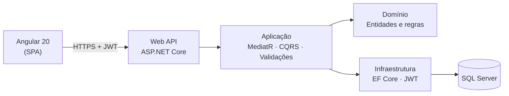

<div align="center">

# 🚗 Locadora de Veículos

**Sistema web para gestão de locadoras de veículos**
Cadastro de funcionários, frota e preços de combustível, com acesso por perfil e dados isolados por empresa.


</div>

---

## 📑 Sumário

- [Sobre o projeto](#-sobre-o-projeto)
- [Funcionalidades](#-funcionalidades)
- [Regras de negócio](#-regras-de-negócio)
- [Tecnologias](#-tecnologias)
- [Arquitetura](#-arquitetura)
- [Como executar](#-como-executar)
- [API](#-api)
- [Estrutura de pastas](#-estrutura-de-pastas)
- [Roadmap](#-roadmap)
- [Autor](#-autor)

---

## 📖 Sobre o projeto

O sistema permite que uma **empresa locadora** crie sua conta, cadastre seus **funcionários** e organize sua operação: grupos de veículos, preços de combustível e, nas próximas etapas, frota, clientes, aluguéis e devoluções.

Cada empresa enxerga **apenas os próprios dados** (multiempresa), e o que cada pessoa pode fazer depende do seu **perfil**: o administrador da empresa gerencia tudo, enquanto o funcionário executa as tarefas operacionais e cuida do próprio cadastro.

> Projeto de estudo desenvolvido a partir de uma especificação da formação da **Academia do Programador**.

---

## ✨ Funcionalidades

### Já implementado

| Módulo | O que faz |
|---|---|
| 🔐 **Autenticação** | Registro da empresa, login, renovação automática da sessão e logout. |
| 👥 **Funcionários** | Cadastro, edição, exclusão e listagem. Ativar e desativar contas. O funcionário acessa o sistema e edita o próprio perfil (**Meu Perfil**). |
| 🚙 **Grupos de Veículos** | Cadastro, edição, exclusão e listagem de grupos (ex.: utilitário, esportivo, adaptado para PCD). |
| ⛽ **Configurações** | Preço por litro da gasolina, gás, diesel e álcool, usado no cálculo dos aluguéis. |

### Em construção

Planos de cobrança · Automóveis · Clientes (pessoa física e jurídica) · Condutores · Taxas e serviços · Aluguéis e devolução · Parceiros e cupons. Veja o [Roadmap](#-roadmap).

---

## 📏 Regras de negócio

- **Multiempresa:** todos os dados pertencem a uma empresa, e uma empresa nunca vê os dados de outra. O isolamento é aplicado automaticamente em todas as consultas.
- **Dois perfis de acesso:**

  | Ação | Empresa (administrador) | Funcionário |
  |---|:---:|:---:|
  | Gerenciar funcionários | ✅ | ❌ |
  | Ativar / desativar contas | ✅ | ❌ |
  | Editar o próprio nome e CPF | — | ✅ |
  | Gerenciar grupos de veículos | ✅ | ✅ |
  | Ler o preço dos combustíveis | ✅ | ✅ |
  | Alterar o preço dos combustíveis | ✅ | ❌ |

- **Funcionário desativado:** perde a sessão imediatamente (os tokens são revogados) e não consegue entrar até ser reativado.
- **Perfil próprio:** o funcionário altera só nome e CPF. Salário e data de admissão são definidos pelo administrador.
- **Validações:** CPF no formato `000.000.000-00`, CPF único por empresa, senha com maiúscula, minúscula e número, preços entre R$ 0,01 e R$ 999,99 com até 2 casas decimais.
- **Exclusão lógica:** os registros excluídos são apenas marcados, e não apagados do banco.

---

## 🛠 Tecnologias

**Back-end**
- [.NET 8](https://dotnet.microsoft.com/) · ASP.NET Core Web API
- [Entity Framework Core 8](https://learn.microsoft.com/ef/core/) com SQL Server (LocalDB em desenvolvimento) e *migrations*
- [ASP.NET Core Identity](https://learn.microsoft.com/aspnet/core/security/authentication/identity) + **JWT** com *refresh token* em cookie
- [MediatR](https://github.com/jbogard/MediatR) (padrão CQRS)
- [FluentValidation](https://docs.fluentvalidation.net/) e [FluentResults](https://github.com/altmann/FluentResults)
- Swagger (Swashbuckle)

**Front-end**
- [Angular 20](https://angular.dev/) (componentes standalone, detecção de mudanças *zoneless*)
- [Angular Material](https://material.angular.dev/) + [Tailwind CSS 4](https://tailwindcss.com/)
- RxJS · ngx-mask · date-fns

---

## 🏗 Arquitetura

O back-end é dividido em camadas, e cada módulo segue o mesmo caminho: **Controller → Comando/Consulta → Handler → Repositório**.



| Camada | Responsabilidade |
|---|---|
| **WebApi** | Controllers, configuração de CORS, autenticação JWT e Swagger. |
| **Aplicação** | Casos de uso: comandos, consultas, *handlers* e validadores. |
| **Domínio** | Entidades e regras de negócio. |
| **Infraestrutura.Orm** | Acesso a dados: `DbContext`, mapeamentos, repositórios e *migrations*. |
| **Infraestrutura.Jwt** | Geração de *access token* e *refresh token*. |

**Segurança:** o *access token* dura 15 minutos e é renovado em segundo plano por um *refresh token* guardado em cookie `HttpOnly`. Ao sair ou ao desativar uma conta, os tokens são revogados.

---

## 🚀 Como executar

### Pré-requisitos

- [.NET 8 SDK](https://dotnet.microsoft.com/download/dotnet/8.0)
- [Node.js](https://nodejs.org/) 20.19 ou superior
- SQL Server **LocalDB** (já vem com o Visual Studio)

### 1. Clonar o repositório

```bash
git clone https://github.com/gustavoduara/LocadoraVeiculos2026.git
cd LocadoraVeiculos2026
```

### 2. Configurar os segredos da API

A API lê as configurações sensíveis dos *user-secrets* (não ficam no repositório):

```bash
cd Server/LocadoraVeiculos2026

dotnet user-secrets set "SQL_CONNECTION_STRING" "Data Source=(localdb)\mssqllocaldb;Initial Catalog=LocadoraVeiculos2026DB;Integrated Security=True;TrustServerCertificate=True"
dotnet user-secrets set "JWT_GENERATION_KEY" "<uma-chave-secreta-com-no-minimo-32-caracteres>"
dotnet user-secrets set "JWT_AUDIENCE_DOMAIN" "http://localhost:9050"
dotnet user-secrets set "CORS_ALLOWED_ORIGINS" "http://localhost:4200"
dotnet user-secrets set "LUCKYPENNY_LICENSE_KEY" "<sua-chave-de-licenca-do-mediatr>"
```

> A chave de licença do MediatR é obtida em [luckypennysoftware.com](https://luckypennysoftware.com).

### 3. Executar a API

Na pasta raiz do repositório:

```bash
dotnet dev-certs https --trust
dotnet run --project Server/LocadoraVeiculos2026 --launch-profile "https [Dev]"
```

Em desenvolvimento, as *migrations* são aplicadas automaticamente na inicialização, e o Swagger fica em **https://localhost:9099/swagger**.

### 4. Executar o front-end

Em outro terminal:

```bash
cd client
npm install
npm start
```

Acesse **http://localhost:4200**, crie a conta da empresa em *Registro* e comece a usar. 🎉

---

## 🔌 API

Todas as rotas (exceto autenticação) exigem o cabeçalho `Authorization: Bearer <token>`.

| Recurso | Rota | Acesso |
|---|---|---|
| **Autenticação** | `POST /api/auth/registrar` · `autenticar` · `rotacionar` · `sair` | Público / logado |
| **Funcionários** | `GET · POST /api/funcionarios`<br>`GET · PUT · DELETE /api/funcionarios/{id}`<br>`PATCH /api/funcionarios/{id}/status` | Empresa |
| **Meu perfil** | `GET · PUT /api/funcionarios/meu-perfil` | Funcionário |
| **Grupos de veículos** | `GET · POST /api/grupos-veiculos`<br>`GET · PUT · DELETE /api/grupos-veiculos/{id}` | Empresa e Funcionário |
| **Configurações** | `GET /api/configuracoes` | Empresa e Funcionário |
| | `PUT /api/configuracoes` | Empresa |

A documentação interativa completa está no Swagger.

---

## 📂 Estrutura de pastas

```
LocadoraVeiculos2026/
├── Server/                                  # Back-end (.NET 8)
│   ├── LocadoraVeiculos2026/                #   WebApi: controllers, config, Program.cs
│   ├── LocadoraVeiculos.Aplicacao/          #   Casos de uso (comandos, handlers, validadores)
│   ├── LocadoraVeiculos.Dominio/            #   Entidades e regras
│   ├── LocadoraVeiculos.Infraestrutura.Orm/ #   EF Core, repositórios e migrations
│   └── LocadoraDeVeiculos.Infraestrutura.jwt/ # Geração de tokens
└── client/                                  # Front-end (Angular 20)
    └── src/app/
        ├── auth/                            #   Login, registro, interceptor e guards
        ├── funcionarios/                    #   CRUD de funcionários e Meu Perfil
        ├── grupo-veiculos/                  #   CRUD de grupos de veículos
        ├── configuracoes/                   #   Preço dos combustíveis
        └── shared/                          #   Menu, notificações e utilitários
```

---

## 🗺 Roadmap

- [x] Autenticação (registro, login, renovação e logout)
- [x] Funcionários (CRUD, ativar/desativar, perfil próprio)
- [x] Grupos de veículos (CRUD)
- [x] Configurações (preço dos combustíveis)
- [ ] Planos de cobrança (diário, controlado e livre)
- [ ] Automóveis (com foto)
- [ ] Clientes (pessoa física e jurídica)
- [ ] Condutores
- [ ] Taxas e serviços
- [ ] Aluguéis e devolução (caução, seguro e multa por atraso)
- [ ] Testes automatizados (unitários e de integração)
- [ ] Pipeline de CI (GitHub Actions) e *containers*
- [ ] Parceiros e cupons de desconto

---

## 👤 Autor

**Gustavo Duara**
[github.com/gustavoduara](https://github.com/gustavoduara)
